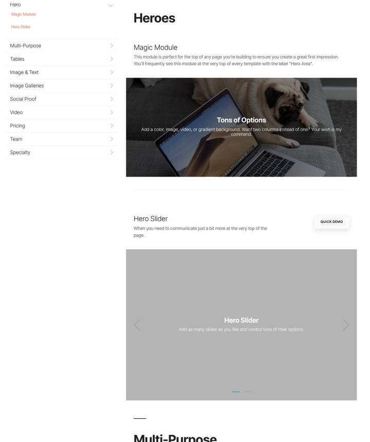
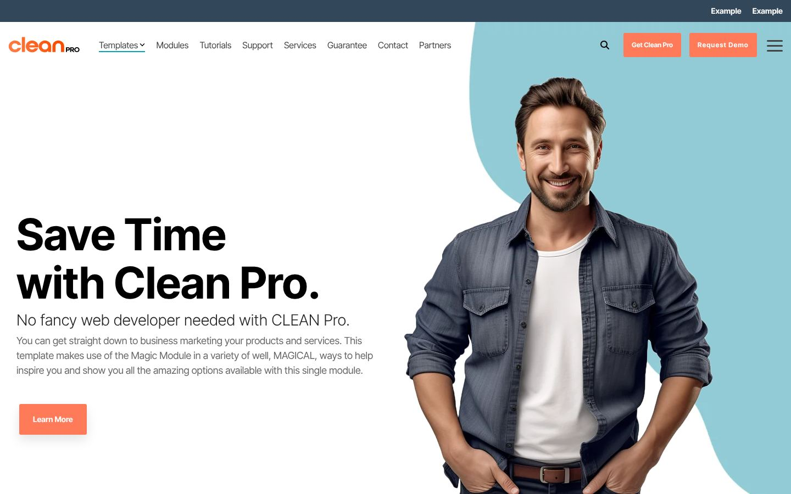
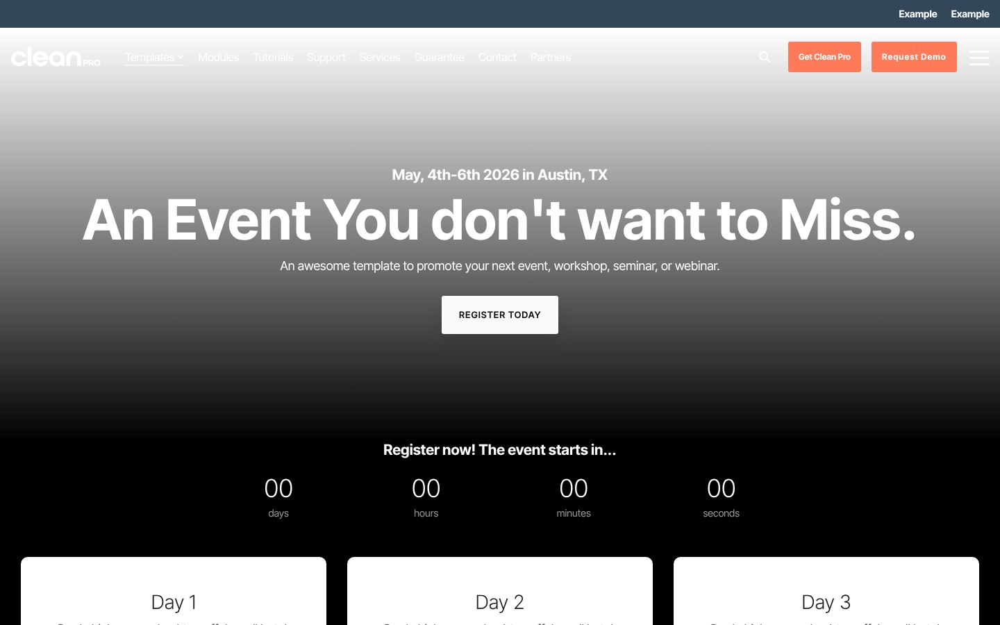
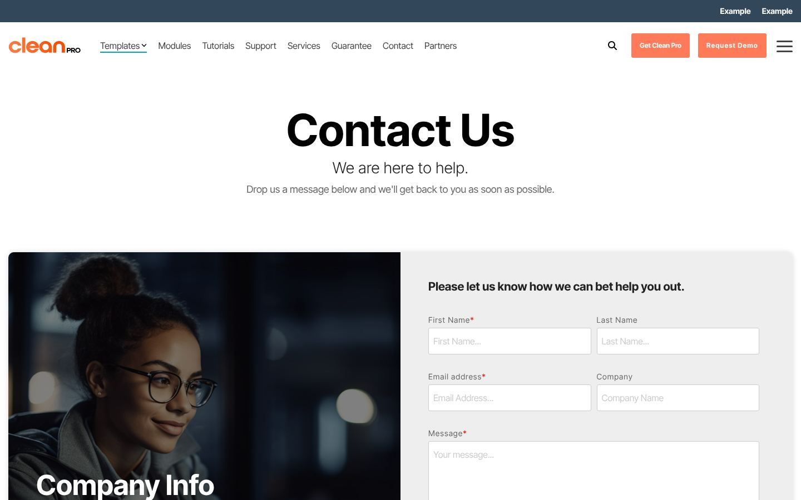
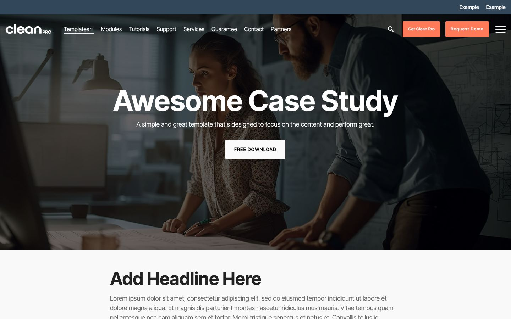
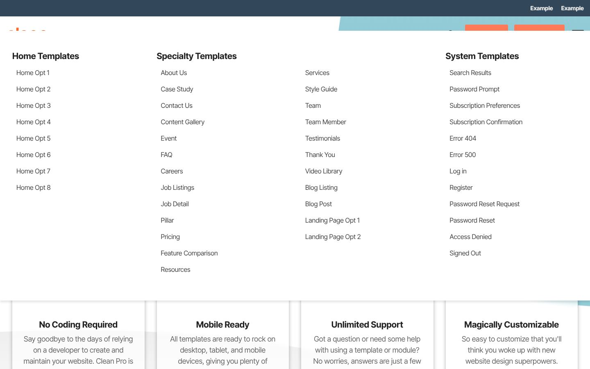
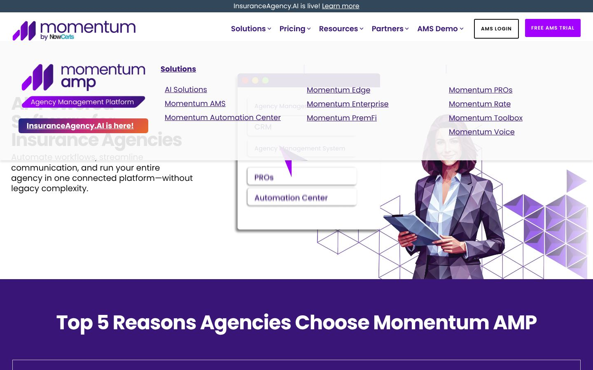

# 1. Neues HubSpot-Theme: Analyse der Beispielseiten (Stand 26.11.2026)

## Ergebnis in Kürze
- **Das Theme ist CLEAN Pro von Helpful Hero.** Im Quelltext belegt: `template_clean-foundation.min.css`, `template_clean-pro.min.js`, `template_mega-menu.min.js` und Module wie `module_CLEAN_Pro_-_Versa_Cards`, `module_CLEAN_Pro_-_Magic_Module`.
- **Nur 2 der 4 Beispielseiten nutzen es wirklich:**

| Beispielseite | System | Theme | Belege im Quelltext |
|---|---|---|---|
| clean.pro | HubSpot | **CLEAN Pro** (Seite des Herstellers) | clean-foundation, clean-pro.js, mega-menu.js, Module Versa Cards, Count Up, Logo Scroller, Video Gallery, Image Gallery Grid |
| momentumamp.com | HubSpot | **CLEAN Pro als Child-Theme** (`template_child.min.css`) | gleiche Theme-Dateien, Module Magic Module, Versa Cards, Content Slider, Logo Scroller |
| flipsidegroup.com.au | HubSpot | **eigenes Theme**, nicht CLEAN | eigene Module `fs-main-banner`, `split-hero`, `numbered-card-grid`, `site-header` |
| cloudcapsule.io | **kein HubSpot** | Next.js mit Sanity-CMS | `_next/static`, Bilder von `cdn.sanity.io` |

  Vermutung: flipside und cloudcapsule waren früher Referenzen in der CLEAN-Galerie und wurden inzwischen umgebaut. Als Vorbild für „das kann CLEAN“ taugen nur clean.pro und momentumamp.com.
- **momentumamp.com zeigt das Wichtigste:** Mit einem Child-Theme lässt sich CLEAN Pro komplett in eine eigene Marke umfärben (eigene Schrift Poppins, Lila statt Orange, eigene Grafiken). Genau so würde REMIRA es nutzen: Source Sans 3, Schwarz/Weiß, #41B6E6, Ring.

Bilder: `theme/screenshots/` (Erstansicht und Menü je Seite, 1440 und 390 px), `theme/uebersicht/` (ganze Seiten verkleinert, Kundenstimmen unkenntlich), `theme/module/` (Modul-Katalog je Kategorie), Messwerte `theme/messwerte.json`, Lighthouse `theme/lighthouse-beispielseiten.txt`. Skript: `tools/theme-shots.cjs`.

## Was kann das Theme?
Quelle: Modul-Katalog [clean.pro/modules](https://www.clean.pro/modules) und Vorlagen-Menü auf clean.pro, selbst angesehen.

### Module (35 im Katalog sichtbar, Hersteller nennt 50)
| Kategorie | Module | Bild |
|---|---|---|
| Hero | Magic Module (Text, Bild/Video, Hintergrundbild/-video/Verlauf, Formular, Buttons, Lottie, rotierender Text, Icons, Bild-Ebenen, Parallax, „smooth animations“), Hero Slider (auch zweispaltig, mit Formular) |  |
| Multi-Purpose | Magic Module, Versa Cards (Karten mit Filter, auch als Testimonial- und Team-Karten), Content Slider (Beta), Multi-Column Accordion | `theme/module/02-multi-purpose.jpg` |
| Tabellen | Flexi Table, Table Flow | `theme/module/03-tabellen.jpg` |
| Bild und Text | Image and Text Opt 1, Icon & Text, Hover Cards, Hover Swap, Before & After Image Slider | `theme/module/04-bild-und-text.jpg` |
| Galerien | Image Gallery Grid, Masonry Image Gallery, Image Grid | `theme/module/05-galerien.jpg` |
| Social Proof | Versa Cards (Testimonial), Testimonial Scroller, Logo Scroller, Number Count Up, Super Social Proof (Video/Bild-Referenzen mit Kennzahl) | `theme/module/06-social-proof.jpg` |
| Video | Video Gallery, Video Playlist | `theme/module/07-video.jpg` |
| Preise | Pricing Table, Pricing Comparison Table (Monat/Jahr-Schalter) | `theme/module/08-preise.jpg` |
| Team | Versa Cards (Team-Profil), Job Listing Table | `theme/module/09-team.jpg` |
| Spezial | Card Flippers, Countdown Timer, Event Schedule, Tabbed Content, Flexi Tabs, Product Detail, Timeline, Meeting Scheduler, Scroll Swap | `theme/module/10-spezial.jpg` |

### Seiten-Vorlagen (Mega-Menü „Templates“ auf clean.pro)
- **8 Startseiten-Varianten** (Home Opt 1–8)
- **Spezial:** About Us, Case Study, Contact Us, Content Gallery, Event, FAQ, Careers, Job Listings, Job Detail, Pillar, Pricing, Feature Comparison, Resources, Services, Style Guide, Team, Team Member, Testimonials, Thank You, Video Library, Blog Listing, Blog Post, Landing Page Opt 1 und 2
- **System:** Suche, 404/500, Passwort, Abo-Einstellungen, Login/Registrierung (Mitgliederbereich)

Passend für REMIRA: Home, Case Study (Referenzen), Event (Webinare), Contact Us (Demo), Feature Comparison (Modul-Vergleich), Pillar (Glossar/Ratgeber), Resources, Blog, Careers.

| Vorlage | Bild |
|---|---|
| Startseite (Home Opt 1) |  |
| Event mit Countdown |  |
| Kontakt mit Formular |  |
| Case Study |  |
| Mega-Menü |  |
| Kundenbeispiel Momentum (Child-Theme, Mega-Menü) |  |

### Navigation, Typografie, Farben, Bewegung
- **Mega-Menü:** großes Panel über die ganze Breite, frei in Spalten aufteilbar (clean.pro: 4 Spalten Vorlagen; Momentum: 3 Spalten Produkte plus Bild/Badge). Am Handy Burger-Menü mit Akkordeon. Kopfzeile auf den Beispielen **nicht** mitlaufend (nicht sticky).
- **Typografie:** frei über Theme-Einstellungen. clean.pro: Inter Tight, H1 80 px/700, Fließtext 18/27 px. Momentum: Poppins, H1 44–60 px, Fließtext 16/24 px.
- **Farben:** frei; clean.pro Orange #FF7A59 auf Weiß mit Dunkelblau, Buttons mit 3 px Radius; Momentum Lila #A200FF.
- **Bewegung:** zurückhaltend. Mitgeliefert: Slick-Slider, Zahlen-Hochzählen, Morph-/Rotier-Text, Lottie-Animationen, Parallax und Einblendungen im Magic Module, Hover-Karten, Card Flippers, Scroll Swap. **Nicht** mitgeliefert: 3D, Maus-reaktive Hintergründe, magnetische Elemente, Scroll-Bühnen. Diese Effekte (Davids „10.000-€-Website“) bleiben eigene Module (b).
- **Technik:** jQuery-Modal und Slick (jQuery-basiert) sind Teil des Themes. Gegenüber remira.com heute (drei Slider-Bibliotheken, Font Awesome doppelt) trotzdem schlanker, weil nur ein Slider-System.

### Ladezeit
Siehe `theme/lighthouse-beispielseiten.txt` (mobil). Die Theme-Vorlagen selbst sind leicht (0,5–0,9 MB). Schwer wird es durch Inhalte: clean.pro-Startseite 4–6 MB (Bildergalerie), Momentum-Startseite rund 30 MB (Hero-Video). Lehre für REMIRA: Hero-Videos und große Galerien vermeiden bzw. stark komprimieren.

## Messgrenze
Ein paar Hosts sind in der Umgebung noch gesperrt: Video-Player (`player.vimeo.com`, `www.youtube.com`, `play.hubspotvideo.com`), Lottie-Dateien (`lottie.host`) und einzelne HubSpot-Bildserver (`*.hubspotusercontent-na2.net`, `f.hubspotusercontent30.net`, `cdn2.hubspot.net`). Deshalb fehlen im Modul-Katalog einige Beispielbilder und Videos (z. B. Content Slider, Scroll Swap, Meeting Scheduler sind leer). Für ein vollständiges Bild diese Domains zusätzlich freigeben; für die Entscheidungen hier reicht der Stand.

## Lizenz und KI-Anbindung (öffentliche Angaben)
- HubSpot Marketplace: ca. 997 USD, Version 127 (Okt. 2026), Voraussetzung „HubSpot Subscription“; ob einmalig oder Abo und welche CMS-Stufe nötig ist, steht dort nicht eindeutig. Auf clean.pro beworben: unbegrenzter E-Mail-Support, 2 Stunden Anpassung, Updates auf Lebenszeit.
- „Clean Pro Connector“ (mcp.clean.pro): Seiten mit Claude direkt in HubSpot bauen. Spannend für die Umsetzung der Mockups, braucht aber Freigabe von Marketingleitung und IT (Schreibzugriff aufs Portal).

## Quellen
- [Clean Pro – Module](https://www.clean.pro/modules), [clean.pro](https://www.clean.pro/), [Release Notes](https://www.clean.pro/release-notes)
- [CLEAN Pro im HubSpot Marketplace](https://ecosystem.hubspot.com/marketplace/website/clean-theme-by-helpful-hero)
- [Clean Pro Connector](https://mcp.clean.pro/)
- Beispielseiten: momentumamp.com, flipsidegroup.com.au, cloudcapsule.io (Quelltext am 26.11.2026 geprüft)
