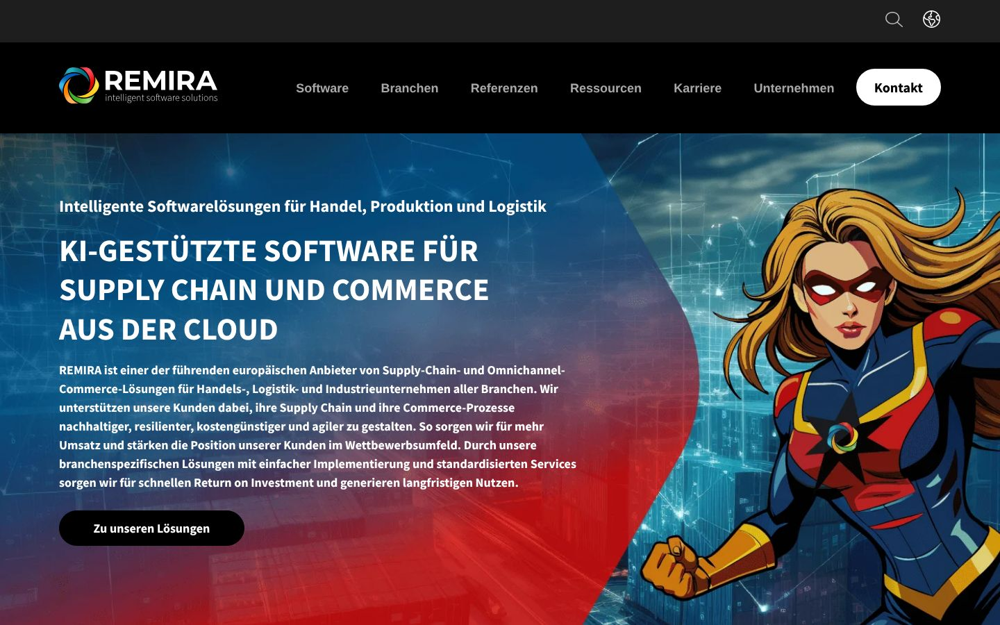
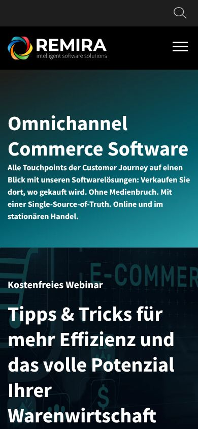
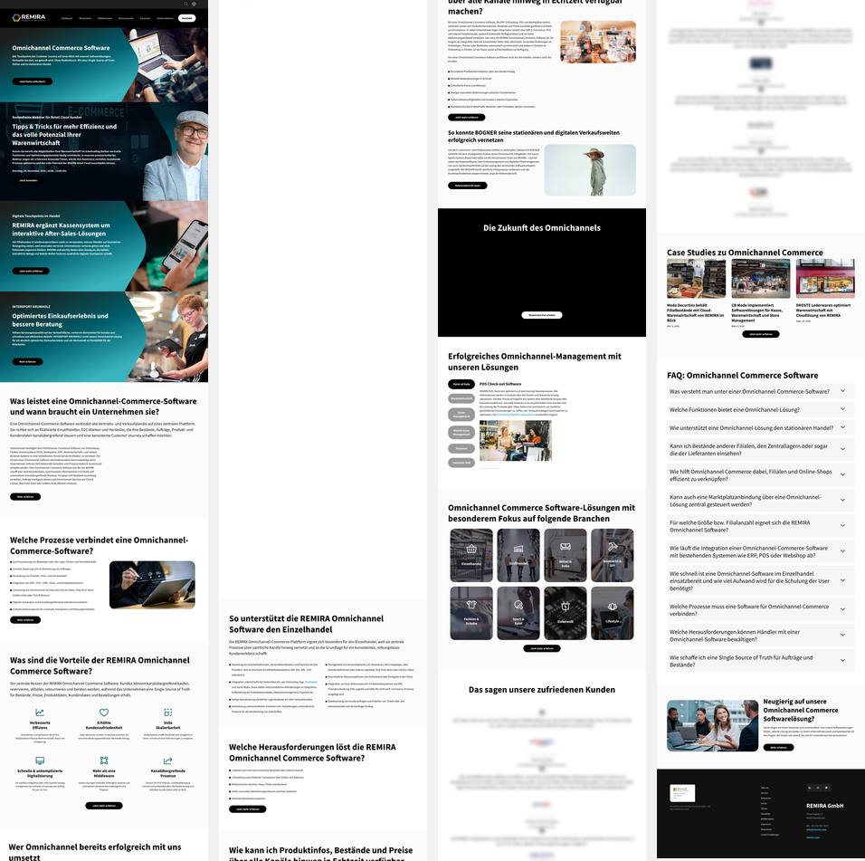

# 2. Audit remira.com (gemessen am 26.11.2026)

Geprüft: 7 Seiten, je Desktop 1440 px und Handy 390 px, mit Playwright (Screenshots, Ladezeit, Bildgrößen, Überschriften, CTAs, Kontrast) und Lighthouse 13.6 (mobil und Desktop, 5 Seiten).
Seiten: Start `/de/`, Plattform, Omnichannel Commerce, Order Management, Branche Fashion & Schuhe, Webinare, Kontakt.

> **Messgrenze:** In der Cloud-Umgebung waren nur remira.com-Hosts erreichbar. Fremd-Skripte (cdnjs, jsdelivr, Font Awesome, Usercentrics-Cookie-Banner, HubSpot-Modul-CDN) wurden **nicht geladen**. Folgen: In den Screenshots fehlen Slider-Funktion, Logo-Leisten und Cookie-Banner (Slider-Folien stehen untereinander, Logo-Leisten erscheinen als weiße Lücke), und die echten Ladezeiten und Lighthouse-Werte sind **schlechter** als hier gemessen. Für belastbare Zahlen einmal PageSpeed Insights (pagespeed.web.dev) von einem normalen Rechner laufen lassen.

Dateien: `audit/screenshots/` (Erstansicht je Seite und Gerät), `audit/uebersicht/` (ganze Seite verkleinert, Kundenzitate unkenntlich gemacht), `audit/messwerte.json`, `audit/lighthouse-zusammenfassung.txt`, Skript `tools/audit-shots.cjs`.

## Zahlen
| Seite | Lighthouse Perf. mobil / Desktop | LCP mobil | Barrierefreiheit | Seitenlänge Handy | Wörter | Datenmenge* |
|---|---|---|---|---|---|---|
| Start | 78 / 92 | 5,4 s | 90 | 25.500 px (≈ 30 Bildschirme) | 1.380 | 2,3 MB |
| Omnichannel Commerce | 91 / 99 | 3,2 s | 88 | 33.900 px (≈ 40) | 1.830 | 4,1 MB |
| Order Management | 76 / 95 | 6,4 s | 91 | 25.000 px (≈ 30) | 1.240 | 2,1 MB |
| Fashion & Schuhe | 76 / 95 | 6,0 s | 90 | 18.600 px (≈ 22) | 880 | 1,0 MB |
| Kontakt | 85 / 99 | 3,6 s | 91 | 6.100 px | 400 | 1,3 MB |
| Webinare | – | – | – | 22.200 px | 1.880 | 3,4 MB |
| Plattform | – | – | – | 22.000 px | 1.110 | 2,1 MB |

\* Playwright-Messung ohne Fremd-CDNs. Zielwerte: LCP mobil unter 2,5 s, Perf. mobil ab 90. Server-Antwort (TTFB 100–430 ms) und Layout-Stabilität (CLS ≤ 0,08) sind gut.

## Befunde (wichtigste zuerst)

### Struktur und Navigation
1. **Commerce ist nicht als Bereich sichtbar.** Hauptmenü: Software · Branchen · Referenzen · Ressourcen · Karriere · Unternehmen. Supply-Chain- und Commerce-Produkte stehen gemischt unter „Software“. Die Commerce-Module (Point of Sale, Warenwirtschaft, Mobile Store Management, Payment, Customer Hub) gibt es nur als Tabs innerhalb der Commerce-Seite: keine eigenen URLs, über Suche und Menü nicht auffindbar.
2. **Kein „Demo“ im Menü.** Oben steht nur „Kontakt“. Demo-CTAs heißen je Seite anders („Jetzt Demo anfordern!“, „Mehr erfahren“, „Jetzt mehr erfahren“, „Showroom live erleben“, „Zu unseren Lösungen“).
3. **Sehr lange Seiten.** Commerce am Handy ≈ 40 Bildschirmhöhen, viele Abschnitte wiederholen sich seitenübergreifend (Branchen-Kacheln, Kundenstimmen, Blog-Karten, „Neugierig auf …“-Band).
4. **Mehrere H1 je Seite** (Start und Commerce je 8, weil jede Slider-Folie eine H1 ist); Lighthouse meldet zudem falsche Überschriften-Reihenfolge. Schadet SEO und Screenreadern.

### Lesbarkeit und Branding
5. **Kontrast und Barrierefreiheit:** Lighthouse meldet auf Commerce 5 Textstellen mit zu wenig Kontrast (u. a. Grau #A8A8A8 auf Grau #999999). Auf allen 5 geprüften Seiten: Links ohne erkennbaren Namen (z. B. reine Icon-Links), nicht crawlbare Links, falsche ARIA-Struktur, falsche Überschriften-Reihenfolge.
6. **Textwände im Hero:** Start-Hero Desktop mit 7 Zeilen Fließtext und Headline in Versalien; Handy zeigt einen anderen Hero als Desktop.
7. **Schriftgrößen am Handy** meist 16 px, einzelne Texte 13 px; Fließtext-Zeilen am Desktop sehr lang (Hero bis ca. 750 px Breite). Tippziele bestehen den Lighthouse-Test.
8. **Icons doppelt:** REMIRA nutzt Phosphor (als 512-px-PNG in 5 Farben hochgeladen), die Seite lädt aber zusätzlich Font Awesome zweimal (CSS 6.4.2 und Kit).
9. **Heldin im Hero** ist ein starkes, eigenständiges Motiv, steht aber neben Stockfotos in Teal/Blau-Verläufen. Bildsprache uneinheitlich (Comic, Stock, Produkt-Screenshots, Verläufe).

### Technik und Tempo
10. **LCP-Bild zu spät entdeckt:** Das Hero-Bild ist ein CSS-Hintergrund und startet erst nach ca. 1 s (Lighthouse „LCP request discovery“). Dazu 0,7–0,8 s render-blockierende Dateien und ca. 0,3 s Schrift-Nachladen.
11. **Bilder:** 70–80 % der Datenmenge. Je Seite 11–25 Bilder mindestens doppelt so groß wie angezeigt (Phosphor-Icons 512 × 512 px für 70–80 px Anzeige → als SVG wären es wenige KB). Formate nur JPG/PNG.
12. **Altlasten im Code:** jQuery 1.12.4 (von 2016, bekannte Sicherheitslücken), drei Slider-Bibliotheken parallel (Swiper 11, Owl Carousel 2.3.4, Slick 1.9.0), Font Awesome doppelt.

13. **Konsolenfehler** auf allen Seiten (teils wegen der hier gesperrten Fremd-Skripte, deshalb im normalen Browser gegenprüfen).

### Was gut ist (beibehalten)
- Schnelle Server-Antwort über HubSpot/Cloudflare, Lazy Loading bei fast allen Bildern
- Alle Bilder mit Alt-Text, Canonical und hreflang (DE/EN/…) gesetzt, Meta-Descriptions vorhanden
- FAQ-Blöcke auf Produktseiten (gut für Suche und KI-Antworten)
- Schrift Source Sans Pro und Phosphor-Icons sind bereits Markenstandard

## Bilder
| Desktop | Handy |
|---|---|
|  |  |
|  |  |

Seitenverlauf Commerce (Desktop, verkleinert): 
